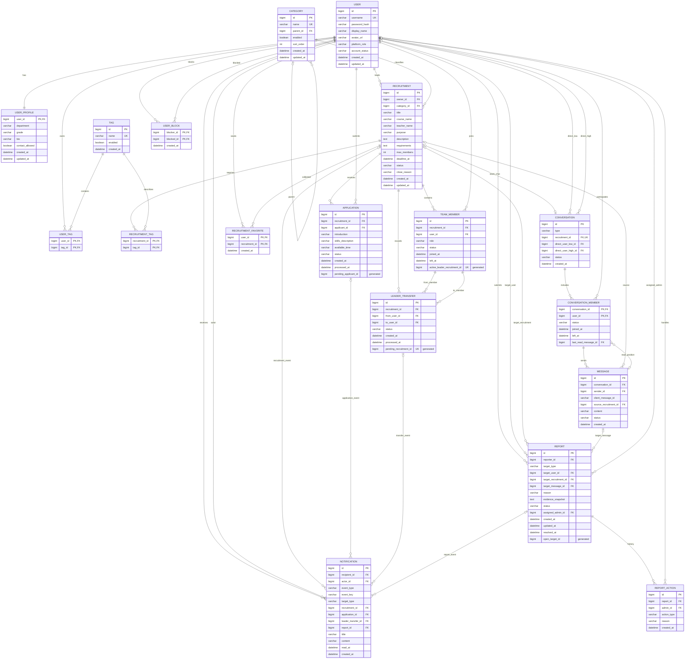

# 招募平台 ER 设计

本文与 `database/recruitment-init.sql` 对齐。申请、成员管理、收藏、转交、聊天、通知、屏蔽和举报属于后续数据基础，建表不代表对应接口已经实现。SQL 要求 MySQL 8.0.16 及以上版本，并会重建 `teamflow_recruitment` 中的表。已有库应通过独立迁移升级。

## 1. 完整实体关系

## 2. 表职责
| 表 | 用途 |
| --- | --- |
| user | 登录账号和基础身份 |
| user_profile | 院系、年级、简介等公开资料 |
| category | 课堂组队、学科竞赛等招募分类 |
| tag | 技能标签 |
| user_tag | 用户与技能标签的多对多关系 |
| recruitment | 一条具体的组队招募 |
| recruitment_tag | 招募与技能标签的多对多关系 |
| application | 用户提交的加入申请 |
| team_member | 已确认加入招募的正式成员 |

## 3. 关键规则
- recruitment.owner_id 是招募负责人。
- 创建招募时，负责人同时写入 team_member，角色为 LEADER。
- application 只表示申请，不代表正式入队。
- 只有申请被接受后，才创建 team_member 记录。
- application 的状态包括：
  PENDING、ACCEPTED、REJECTED、WITHDRAWN、EXPIRED。
- team_member 的角色包括：
  LEADER、MEMBER。
- team_member 的状态包括：
  ACTIVE、LEFT、REMOVED。
- 同一用户对同一招募最多只能有一条 PENDING 申请。
- 同一用户在同一招募中最多只能有一条有效成员关系。
- 招募的有效成员数量不能超过 max_members。
- 负责人计入正式成员数量。
- 站外成员只作为文本介绍，不创建 team_member。

## 4. 后续 P0 完整关系

完整 ER 图已包含后续九表。举报和通知的可选目标由 CHECK 约束互斥，必须且只能选择其中一个。

后续九表的字段字典和关键约束见第 5 节，事务要求见第 7 节。

## 5. 字段、约束与索引

### 5.1 通用约定

- 主外键采用 BIGINT UNSIGNED。“必填”表示 NOT NULL，“可空”表示 NULL，可空列未指定其他默认值时默认为 NULL。
- id 为自增主键。created_at 默认 CURRENT_TIMESTAMP，updated_at 默认当前时间且自动更新。状态默认值和业务唯一约束按各表说明。
- 引擎为 InnoDB，字符集为 utf8mb4，默认排序规则为 utf8mb4_0900_ai_ci。幂等键使用 utf8mb4_bin，避免大小写被折叠。
- DATETIME 与现有 LocalDateTime 保持一致，应用和数据库统一部署时区，不保存时区偏移。
- 所有外键 ON UPDATE RESTRICT。收藏和屏蔽的用户外键 ON DELETE CASCADE，后续表的其他外键 ON DELETE RESTRICT，保留历史与证据。
- 每个外键均有显式或 InnoDB 自动建立的索引。以下列出业务查询索引及业务唯一约束。

### 5.2 招募收藏 recruitment_favorite

| 字段 | 类型 | 空值与默认 | 含义 |
| --- | --- | --- | --- |
| user_id | BIGINT UNSIGNED | 必填 | 收藏人，用户外键 |
| recruitment_id | BIGINT UNSIGNED | 必填 | 招募外键 |
| created_at | DATETIME | 必填，当前时间 | 收藏时间 |

- 组合主键 `(user_id, recruitment_id)` 防止重复收藏。取消时删除关系，重复取消幂等。
- `(user_id, created_at, recruitment_id)` 支持个人收藏分页，`(recruitment_id, created_at)` 支持招募收藏统计。
- 业务层只允许收藏公开招募，草稿不会产生收藏关系。

### 5.3 负责人转交 leader_transfer

| 字段 | 类型 | 空值与默认 | 含义 |
| --- | --- | --- | --- |
| id | BIGINT UNSIGNED | 必填，自增 | 主键 |
| recruitment_id | BIGINT UNSIGNED | 必填 | 招募外键 |
| from_user_id | BIGINT UNSIGNED | 必填 | 原负责人，与 recruitment_id 组合引用 team_member |
| to_user_id | BIGINT UNSIGNED | 必填 | 接收人，与 recruitment_id 组合引用 team_member |
| status | VARCHAR(20) | 必填，PENDING | PENDING / ACCEPTED / REJECTED / CANCELLED / EXPIRED |
| created_at | DATETIME | 必填，当前时间 | 发起时间 |
| processed_at | DATETIME | 可空 | 待处理时为空，结束时必填，由 CHECK 约束 |
| pending_recruitment_id | BIGINT UNSIGNED | 自动生成 | 待处理时等于 recruitment_id，其他状态为空 |

- pending_recruitment_id 唯一，确保同一招募至多一笔待确认转交。CHECK 禁止转交给自己。
- 两个成员组合外键保证双方存在该招募成员关系，在队状态和当前负责人身份由事务校验。
- `(recruitment_id, created_at, id)` 查询转交历史，`(to_user_id, status, created_at)` 查询接收人待办。
- 发起转交不直接修改 owner_id，接收人同意后原子更新负责人和成员角色。

### 5.4 会话 conversation

| 字段 | 类型 | 空值与默认 | 含义 |
| --- | --- | --- | --- |
| id | BIGINT UNSIGNED | 必填，自增 | 主键 |
| type | VARCHAR(20) | 必填 | DIRECT / TEAM |
| recruitment_id | BIGINT UNSIGNED | 可空 | TEAM 必填，DIRECT 必须为空，招募外键 |
| direct_user_low_id | BIGINT UNSIGNED | 可空 | DIRECT 中较小用户 ID，用户外键 |
| direct_user_high_id | BIGINT UNSIGNED | 可空 | DIRECT 中较大用户 ID，用户外键 |
| status | VARCHAR(20) | 必填，ACTIVE | ACTIVE / READ_ONLY |
| created_at | DATETIME | 必填，当前时间 | 创建时间 |

- CHECK 强制两种身份字段互斥。DIRECT 用户必须非空且 low < high，TEAM 中两个私聊用户字段必须为空。
- recruitment_id 唯一保证一条招募最多一个群，用户对组合唯一保证两人共享一个私聊。MySQL 唯一索引允许多条 NULL，不占用另一类型的唯一键。
- READ_ONLY 为后续治理与归档预留，不增加招募状态转换。

### 5.5 会话成员 conversation_member

| 字段 | 类型 | 空值与默认 | 含义 |
| --- | --- | --- | --- |
| conversation_id | BIGINT UNSIGNED | 必填 | 会话外键，组合主键第一列 |
| user_id | BIGINT UNSIGNED | 必填 | 用户外键，组合主键第二列 |
| status | VARCHAR(20) | 必填，ACTIVE | ACTIVE / LEFT / REMOVED |
| joined_at | DATETIME | 必填，当前时间 | 当前关系最近加入时间 |
| left_at | DATETIME | 可空 | ACTIVE 时为空，退出或移除时必填 |
| last_read_message_id | BIGINT UNSIGNED | 可空 | 最后确认已读消息，未阅读时为空 |

- 组合主键保证一人一会话只有一条关系，重新入队时更新已有关系。
- `(conversation_id, last_read_message_id)` 组合外键引用 message 的 `(conversation_id, id)` 唯一键，防止已读位置指向其他会话。
- `(user_id, status, conversation_id)` 支持当前用户会话列表。
- DIRECT 成员集合必须等于规范化用户对，TEAM 成员必须为招募有效成员，由服务层维护跨表集合规则。

### 5.6 消息 message

| 字段 | 类型 | 空值与默认 | 含义 |
| --- | --- | --- | --- |
| id | BIGINT UNSIGNED | 必填，自增 | 主键 |
| conversation_id | BIGINT UNSIGNED | 必填 | 消息所属会话 |
| sender_id | BIGINT UNSIGNED | 必填 | 与 conversation_id 组合引用 conversation_member |
| client_message_id | VARCHAR(64) | 必填 | 同次发送与重试复用的客户端幂等键，utf8mb4_bin |
| source_recruitment_id | BIGINT UNSIGNED | 可空 | 发送时关联的公开招募，招募外键 |
| content | VARCHAR(2000) | 必填 | 文本内容，CHECK 禁止空白 |
| status | VARCHAR(20) | 必填，VISIBLE | VISIBLE / HIDDEN |
| created_at | DATETIME | 必填，当前时间 | 服务端发送时间 |

- `(conversation_id, sender_id, client_message_id)` 唯一。重试读取已有消息并核对原请求，不重复发送。
- `(conversation_id, id)` 唯一供已读位置引用，`(conversation_id, created_at, id)` 支持稳定历史分页。
- 成员外键证明发送者关系存在，ACTIVE 状态、会话可写及屏蔽规则由发送事务校验。
- HIDDEN 保留原消息，避免破坏已读位置和举报引用，消息不物理删除。

### 5.7 用户屏蔽 user_block

| 字段 | 类型 | 空值与默认 | 含义 |
| --- | --- | --- | --- |
| blocker_id | BIGINT UNSIGNED | 必填 | 屏蔽发起人，用户外键 |
| blocked_id | BIGINT UNSIGNED | 必填 | 被屏蔽人，用户外键 |
| created_at | DATETIME | 必填，当前时间 | 屏蔽时间 |

- 组合主键防止重复，CHECK 禁止屏蔽自己，反向索引 `(blocked_id, blocker_id)` 支持双向检查。
- 单条记录表示单向屏蔽，任一方向存在记录时禁止两人私聊发送。取消屏蔽删除本人发起的关系，保留聊天历史。
- 群内屏蔽行为后续单独制定，不自动移除群成员。

### 5.8 举报 report

| 字段 | 类型 | 空值与默认 | 含义 |
| --- | --- | --- | --- |
| id | BIGINT UNSIGNED | 必填，自增 | 主键 |
| reporter_id | BIGINT UNSIGNED | 必填 | 举报人，用户外键 |
| target_type | VARCHAR(20) | 必填 | USER / RECRUITMENT / MESSAGE |
| target_user_id | BIGINT UNSIGNED | 可空 | 被举报用户外键 |
| target_recruitment_id | BIGINT UNSIGNED | 可空 | 被举报招募外键 |
| target_message_id | BIGINT UNSIGNED | 可空 | 被举报消息外键 |
| reason | VARCHAR(1000) | 必填 | 原因，CHECK 禁止空白 |
| evidence_snapshot | TEXT | 可空 | 权限校验后由服务端保存的必要证据快照 |
| status | VARCHAR(20) | 必填，PENDING | PENDING / PROCESSING / RESOLVED / DISMISSED |
| assigned_admin_id | BIGINT UNSIGNED | 可空 | 处理人，用户外键，管理员身份由服务端检查 |
| created_at | DATETIME | 必填，当前时间 | 举报时间 |
| updated_at | DATETIME | 必填，自动更新时间 | 最新处理时间 |
| resolved_at | DATETIME | 可空 | 未结案时为空，RESOLVED / DISMISSED 时必填 |
| open_target_id | BIGINT UNSIGNED | 自动生成 | 未结案时取唯一非空目标 ID，结案后为空 |

- CHECK 强制 target_type 与三个目标外键一致，且恰好一个目标非空。
- `(reporter_id, target_type, open_target_id)` 唯一，阻止同人对同目标重复提交未结案举报，保留结案后再举报的能力。
- `(status, created_at, id)` 支持处理队列，`(reporter_id, created_at, id)` 支持本人记录，`(assigned_admin_id, status, created_at)` 支持管理员待办。
- 私信举报仅展示用户主动提交的消息及必要上下文，管理员角色不授予任意浏览私人会话的权限。

### 5.9 举报处理记录 report_action

| 字段 | 类型 | 空值与默认 | 含义 |
| --- | --- | --- | --- |
| id | BIGINT UNSIGNED | 必填，自增 | 主键 |
| report_id | BIGINT UNSIGNED | 必填 | 举报外键 |
| admin_id | BIGINT UNSIGNED | 必填 | 操作人，用户外键，写入前检查 ADMIN 权限 |
| action_type | VARCHAR(30) | 必填 | ASSIGN / NOTE / HIDE_CONTENT / RESTORE_CONTENT / RESTRICT_USER / DISABLE_USER / RESTORE_USER / RESOLVE / DISMISS |
| reason | VARCHAR(1000) | 必填 | 操作依据，CHECK 禁止空白 |
| created_at | DATETIME | 必填，当前时间 | 操作时间 |

- 一个举报对应多条只追加记录，`(report_id, created_at, id)` 支持历史查询，`(admin_id, created_at, id)` 支持操作人审计。
- 处理记录和目标真实变更必须同事务提交，不能仅插入记录宣称操作已生效。
- message 已预留 HIDDEN，user 已有 RESTRICTED / DISABLED。招募隐藏字段与公开查询过滤在治理功能开发时一并补充。
- 普通业务接口不提供处理记录的修改和删除。

### 5.10 站内通知 notification

| 字段 | 类型 | 空值与默认 | 含义 |
| --- | --- | --- | --- |
| id | BIGINT UNSIGNED | 必填，自增 | 主键 |
| recipient_id | BIGINT UNSIGNED | 必填 | 接收者，用户外键 |
| actor_id | BIGINT UNSIGNED | 可空 | 操作者，系统事件为空，用户外键 |
| event_type | VARCHAR(40) | 必填 | 下表所列事件枚举 |
| event_key | VARCHAR(100) | 必填 | 一次具体事件的稳定幂等键，utf8mb4_bin |
| target_type | VARCHAR(20) | 必填 | RECRUITMENT / APPLICATION / LEADER_TRANSFER / REPORT |
| recruitment_id | BIGINT UNSIGNED | 可空 | 招募目标外键 |
| application_id | BIGINT UNSIGNED | 可空 | 申请目标外键 |
| leader_transfer_id | BIGINT UNSIGNED | 可空 | 转交目标外键 |
| report_id | BIGINT UNSIGNED | 可空 | 举报目标外键 |
| title | VARCHAR(100) | 必填 | 标题 |
| content | VARCHAR(1000) | 必填 | 最小必要摘要 |
| read_at | DATETIME | 可空 | 空为未读，已读写服务端时间 |
| created_at | DATETIME | 必填，当前时间 | 产生时间 |

| 目标 | 事件枚举 |
| --- | --- |
| APPLICATION | APPLICATION_SUBMITTED、APPLICATION_ACCEPTED、APPLICATION_REJECTED、APPLICATION_WITHDRAWN、APPLICATION_EXPIRED |
| RECRUITMENT | RECRUITMENT_TEAMED、RECRUITMENT_CLOSED、MEMBER_JOINED、MEMBER_LEFT、MEMBER_REMOVED |
| LEADER_TRANSFER | LEADER_TRANSFER_REQUESTED、LEADER_TRANSFER_ACCEPTED、LEADER_TRANSFER_REJECTED、LEADER_TRANSFER_CANCELLED、LEADER_TRANSFER_EXPIRED |
| REPORT | REPORT_RESOLVED、REPORT_DISMISSED |

- CHECK 保证 target_type 与四个目标外键互斥，事件与目标类型的对应关系由服务层检查。
- `(recipient_id, event_key)` 唯一，防止重试重复通知。event_key 包含业务对象、事件与本次变更标识，例如 `application/42/accepted`。
- `(recipient_id, created_at, id)` 支持全部通知分页，`(recipient_id, read_at, created_at, id)` 支持未读查询。
- 通知不复制私人聊天正文，跳转目标时需再次检查用户权限。

## 6. 基础表约束补充与删除策略

- application.pending_applicant_id 仅在 PENDING 时等于 applicant_id，其他状态为空。与 recruitment_id 组合唯一，实现同人同招募一条待处理申请，保留已处理历史。
- team_member.active_leader_recruitment_id 仅在 ACTIVE LEADER 时等于 recruitment_id，其余为空，唯一约束保证至多一名有效负责人。
- 普通 CHECK 无法保证至少一名负责人、owner_id 与 LEADER 一致、有效人数不超上限，这些跨表规则由事务维护。
- 招募查询补充 `(status, created_at, id)`、`(owner_id, created_at, id)`、课程和教师索引。关键词包含匹配仍扫描候选记录，当前结合分页控制规模。
- 仅 DRAFT 可删除，已有招募技能、初始成员和申请外键保持 CASCADE。业务层禁止草稿产生申请、收藏、转交、群聊、消息来源及举报等公开关系。
- 后续表对招募采用 RESTRICT，防止误删已有业务历史的招募。RECRUITING 使用关闭，TEAMED / CLOSED 不删除、不重新开放。
- 账号正式删除需单独的数据保留与匿名化方案。禁用账号、隐藏消息使用状态，保留会话和处理历史。
- 会话成员和消息相互引用，初始化时先建成员、再建消息、最后 ALTER TABLE 补已读位置外键。开发重置时临时关闭外键检查，删除完立即恢复。

## 7. 事务与并发控制

| 操作 | 事务内的校验与写入 |
| --- | --- |
| 创建招募 | 从当前身份取得负责人，写招募、技能和 ACTIVE LEADER，一次提交 |
| 编辑、发布、关闭、删除 | 先锁招募行，检查当前负责人及状态，执行允许的操作。人数上限在同一锁内核对 ACTIVE 人数 |
| 提交申请 | 锁招募，确认 RECRUITING、未截止、有名额、非当前成员，再写 PENDING。唯一键兜底重复提交，待处理申请不占名额 |
| 接受申请 | 所有名额和成员变更统一先锁同一招募行，再校验申请状态、人数和已有关系，更新申请、成员与通知。争抢最后一个名额仅一个事务成功 |
| 确认成队 | 锁招募并校验负责人，只允许 RECRUITING → TEAMED，创建唯一 TEAM 会话及全部 ACTIVE 成员关系，PENDING 申请变 EXPIRED 并通知。整体提交，重试读取已有群 |
| 关闭招募 | 仅 RECRUITING → CLOSED。申请和转交上线后，同事务使待处理申请与待确认转交失效并通知。当前阶段只实现已有招募管理 |
| 负责人转交 | 锁招募，再校验 PENDING 转交和接收人在队状态。接受时先将原 LEADER 改为 MEMBER，再提升接收人为 LEADER，同时更新 owner_id、转交与通知。原子提交避免中间状态外泄 |
| 退出或移除成员 | 锁招募，校验权限及成员状态，同时更新 team_member、conversation_member、待处理转交和通知。负责人须先转交，招募中也可先关闭再结束成员关系 |
| 创建私聊 | 规范化用户对并检查联系与屏蔽条件，会话和两条成员关系同事务创建。唯一冲突读取已有会话，不能只创建部分成员 |
| 发送消息与屏蔽 | 私聊先按用户 ID 升序锁两名用户，发送和屏蔽用同顺序，解决屏蔽关系尚不存在时的竞态。随后锁会话，校验 ACTIVE 成员、会话可写及双向屏蔽，再按幂等键写消息 |
| 已读与游标 | 发送持有会话行锁至提交，保证同会话消息 ID 提交顺序。已读也检查成员并锁会话，只允许位置前进，禁止指向其他会话或越过未提交消息 |
| 收藏 | 校验公开可见性，主键冲突视为已收藏，取消和重复取消幂等 |
| 举报处理 | 校验 ADMIN，锁举报并检查状态，更新真实目标、举报、追加处理记录与结果通知后提交。多管理员不能覆盖彼此结果 |
| 通知已读 | 带 recipient_id 条件修改本人通知，未读转已读幂等，不能只按通知 ID 修改 |

多资源操作统一锁顺序，先按用户 ID 升序，再锁招募、会话及其子记录。申请和成员功能必须遵守同一招募锁约定。唯一键约束业务唯一性，服务端事务负责权限、状态、人数与跨表集合规则。死锁采用有限重试并重新检查状态，不允许部分提交。

当前 owner_id 同时承担创建时负责人和当前负责人的含义。“我的招募”当前按 owner_id 查询，转交上线前需确定创建历史是否独立展示，必要时增加 creator_id 并迁移历史数据。
