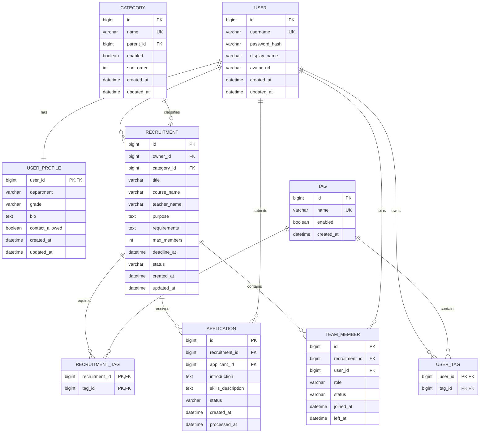

# 招募平台 ER 设计

## 1. 核心实体关系

## 2. 表职责
表	用途
user	登录账号和基础身份
user_profile	院系、年级、简介等公开资料
category	课堂组队、学科竞赛等招募分类
tag	技能标签
user_tag	用户与技能标签的多对多关系
recruitment	一条具体的组队招募
recruitment_tag	招募与技能标签的多对多关系
application	用户提交的加入申请
team_member	已确认加入招募的正式成员

## 2. 关键规则
- recruitment.owner_id 是招募负责人。
- 创建招募时，负责人同时写入 team_member，角色为 LEADER。
- application 只表示申请，不代表正式入队。
- 只有申请被接受后，才创建 team_member 记录。
- application 的状态包括：
  PENDING、ACCEPTED、REJECTED、WITHDRAWN、EXPIRED。
- team_member 的角色包括：
  LEADER、MEMBER。
- team_member 的状态包括：
  ACTIVE、LEFT、REMOVED。
- 同一用户对同一招募最多只能有一条 PENDING 申请。
- 同一用户在同一招募中最多只能有一条有效成员关系。
- 招募的有效成员数量不能超过 max_members。
- 负责人计入正式成员数量。
- 站外成员只作为文本介绍，不创建 team_member。